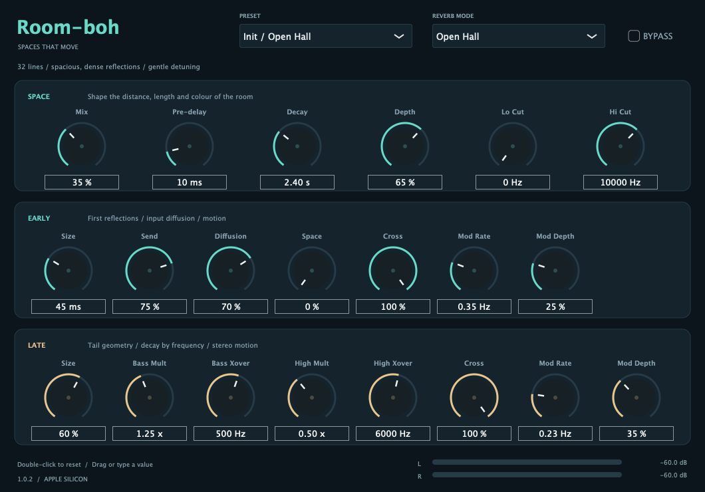

# Room-boh

Riverbero gratuito: VST3 per **Windows x64** e **Mac Apple Silicon**, Audio Unit per Mac.

Produttore: **Valla Productions**.

## Download

Scarica il pacchetto adatto al tuo sistema dalla [release 1.0.3](https://github.com/vallaproductionsoriginal-byte/Room-boh/releases/tag/v1.0.3):

- **Room-boh-win-x64.zip**: Windows 10/11 a 64 bit, VST3.
- **Room-boh-mac-arm64.zip**: Mac Apple Silicon, macOS 11 o successivo, VST3 e Audio Unit.

Il file `SHA256SUMS.txt` permette di verificare l'integrità di entrambi gli ZIP.

## Installazione

### Windows x64

1. Estrai completamente `Room-boh-win-x64.zip` e chiudi la DAW.
2. Copia l'intera cartella `Room-boh.vst3` in `C:\Program Files\Common Files\VST3\`, mantenendo la struttura del bundle. Windows può richiedere i privilegi di amministratore.
3. Riapri la DAW a 64 bit e aggiorna la scansione VST3. Il produttore è **Valla Productions**.

Il runtime MSVC è incluso staticamente. Per disinstallarlo, chiudi la DAW ed elimina la cartella del plugin.

### Mac Apple Silicon

1. Estrai completamente lo ZIP e chiudi la DAW.
2. Copia `Room-boh.vst3` in `~/Library/Audio/Plug-Ins/VST3/` e/o `Room-boh.component` in `~/Library/Audio/Plug-Ins/Components/`. In alternativa esegui `Install.command` dalla cartella estratta per installare entrambi i formati.
3. Riapri la DAW e aggiorna la scansione dei plugin. Se l'Audio Unit non compare, riavvia il Mac e ripeti la scansione.

Serve una DAW con supporto VST3 o Audio Unit eseguita nativamente su Apple Silicon. I bundle hanno una firma ad hoc locale e sono privi di notarizzazione Apple; macOS può richiedere ulteriori verifiche o bloccarne il caricamento.

Per disinstallarlo, chiudi la DAW ed elimina `Room-boh.vst3` e/o `Room-boh.component` dalle rispettive cartelle di installazione.

## Controlli

- **Space:** Mix, Pre-delay, Decay, Depth, Lo Cut e Hi Cut.
- **Early:** Size, Send, Diffusion, Space, Cross, Mod Rate e Mod Depth.
- **Late:** Size, Bass Mult, Bass Xover, High Mult, High Xover, Cross, Mod Rate e Mod Depth.
- **Mode:** Open Hall, Small Studio, Air Bloom, Silk Hall, Warm Loft, Shadow Hall, Night Vault, Orbit, Prism, Nebula, Abyss e Mosaic.
- **Preset:** dodici programmi di fabbrica modificabili.
- **Bypass** e meter stereo RMS/peak.

Mix a 100% per un bus ausiliario. Depth bilancia le riflessioni iniziali e la coda; Decay indica il tempo di decadimento medio approssimativo. Bass Mult e High Mult regolano il decadimento delle rispettive bande. Lo Cut a 0 Hz disattiva il filtro; Cross a 0 rende mono la relativa sezione. Doppio clic per ripristinare il valore iniziale di un controllo; clic sul valore per digitarlo.

## Compatibilità

Sono disponibili configurazioni mono, stereo e ingresso mono con uscita stereo. Il percorso dry ha latenza zero. Tutti i ventitré parametri sono esposti alla DAW e vengono salvati nella sessione. DSP, caricamento VST3, audio, preset, stato ed editor sono verificati su un runner Windows x64 e in un host JUCE locale Mac a 44.1, 48, 96 e 192 kHz; Audio Unit è verificato su Mac; la compatibilità può variare tra DAW.

## Licenza

Il codice e il materiale originali di Room-boh sono soggetti alla **licenza proprietaria** riportata in [LICENSE](LICENSE). Copyright (c) 2026 Francesco Valla. Tutti i diritti riservati. L'uso, anche commerciale, richiede l'autorizzazione espressa del titolare ed è consentito nei limiti del permesso accordato. Modifica, redistribuzione, sublicenza e rivendita richiedono il suo previo consenso scritto. Per le richieste: [vallaproductionsoriginal@gmail.com](mailto:vallaproductionsoriginal@gmail.com). La release pubblica contiene il plugin compilato; i sorgenti sono riservati e accessibili solo alle persone autorizzate.

La distribuzione usa la licenza commerciale JUCE Starter. La licenza proprietaria di Room-boh non si applica ai componenti di terze parti: JUCE e le altre dipendenze conservano i propri termini e avvisi, riportati in [THIRD_PARTY_NOTICES.md](THIRD_PARTY_NOTICES.md) e nella cartella [licenses](licenses).

Per segnalare problemi, apri una issue indicando DAW, versione del sistema operativo, frequenza di campionamento e passaggi per riprodurre il problema.
